<!-- Generated from src/docs/repository-readme.md by src/tools/refresh_latest.py. -->

<h1 align="center">ClioPlay 2.2.7</h1>

Offline navigation and Bluetooth audio for the original Carminat TomTom screen.

  Created and maintained by <a href="https://github.com/pxwel-dev">Pawel (pxwel-dev)</a>.

<a href="https://github.com/pxwel-dev/ClioPlay/releases">Download latest release</a> · <a href="#install">Fresh install</a> · <a href="src/docs/updating.md">Update existing installation</a> · <a href="https://pxwel-dev.github.io/ClioPlay-Send/">Send a destination from your phone</a>

## Version 2.2.7

Version **2.2.7** is a software-only camera warning overhaul (**100% compatible with existing `2.1.8–2.2.6.4` maps** and saved user data; no map rebuild required):

- **Matching upcoming-camera map markers:** Distinct `8×8`-supersampled icons for **Speed**, **Red-light** (with red top lamp) and **Average-speed** (twin-camera) alerts appear strictly for the active upcoming camera (or average-speed exit) straight from RAM with zero per-frame SD reads, following 3D tilt and `Z6–Z9` road snap and turning red when over the limit.
- **Sleek flush `43 px` frosted-glass camera card:** Aligned top-and-bottom with the Speed and Turn pills and dedicated cleanly to the active camera, featuring matching twin icons, clean typography (`Limit XX` only when relevant), a BT-CTRL-style 3 px antialiased capsule progress bar (draining on approach, filling across average-speed zones), synced pulsing red overspeed rim and full RTL mirroring.
- **Smarter detection & reliability:** Speed-scaled warning and chime horizons (~14–22 s lookahead with hysteresis), curved-road unguided corridor matching, high-speed 1 Hz segment-crossing average-speed entry, along-route remaining zone distance with slip-road auto-clear, and exact overspeed parity with the Speed pill.
- **Two-tier audio & `Overspeed audio` mode:** Distinct soft approach vs brisk overspeed chimes over Bluetooth audio, plus a new **Overspeed audio** setting in **Settings → Navigation → Camera alerts** (quiet when compliant on speed/average cameras; soft approach cue only for red-light cameras), keeping the strict fail-closed 19-country policy across all 18 languages.

See [CHANGELOG.md](CHANGELOG.md) for all prior releases, [intelligent navigation](src/docs/intelligent-navigation.md) for local ML behaviour and privacy, and the [zoom & controls guide](src/README.md#auto-zoom-and-close-up-street-names).

## UI previews

All previews below are freshly rendered across real UK map regions (**Manchester**, **Central London**, **Milton Keynes**, **Bristol**, **Liverpool**, **Leeds**, **Edinburgh** and **Newcastle**). See the [full preview index](src/docs/demo/README.md) for all animations.

| Upgraded camera warnings & map markers | Live expandable GPS HUD |
| --- | --- |
| 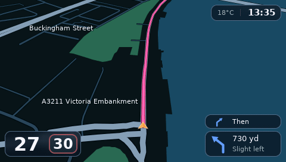 | 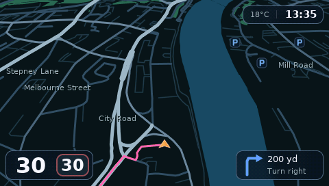 |

| Dynamically-resizing, animated frosted-glass menu | Expandable secondary manoeuvre cue |
| --- | --- |
| 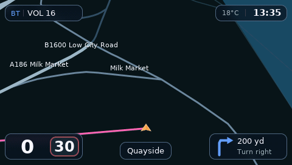 | 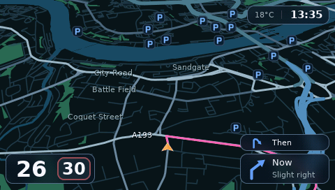 |

| Send a destination with [ClioPlay Send](https://pxwel-dev.github.io/ClioPlay-Send/) | Bluetooth playback and volume |
| --- | --- |
| 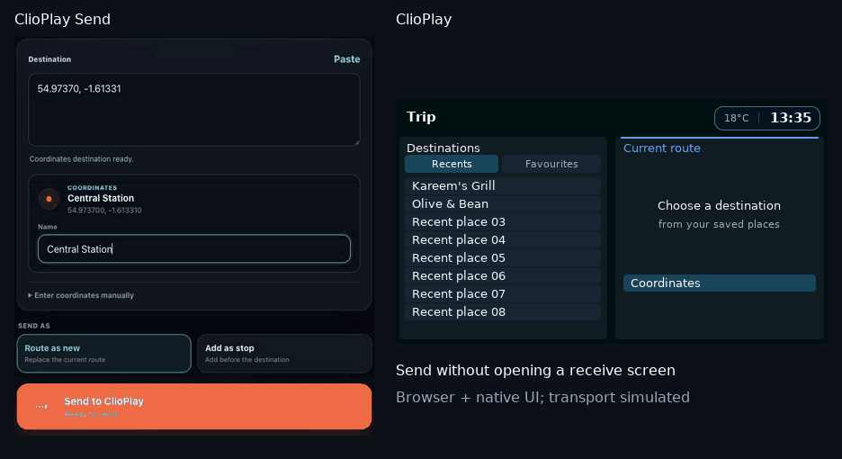 |  |

| Usual route & calibrated ETA ranges | Frequent & cold-weather slowdown alerts |
| --- | --- |
| 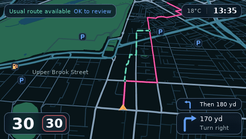 | 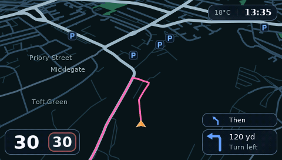 |

| Usual parking, recurring stops & preferred POIs | Offline Nearby POIs |
| --- | --- |
| 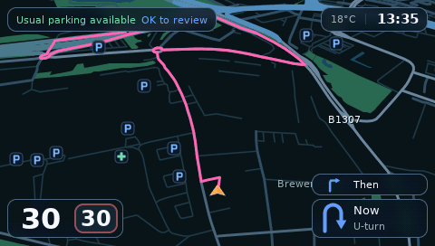 | 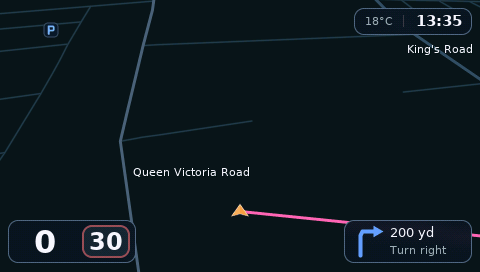 |

| Destination prediction | Frequent-place suggestion |
| --- | --- |
| 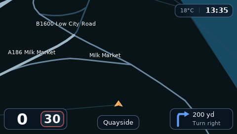 | 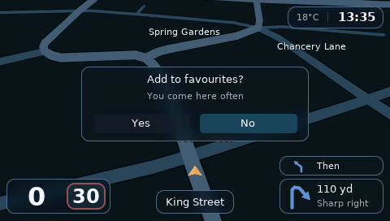 |

| Speeding warning | View and take a diversion |
| --- | --- |
|  | 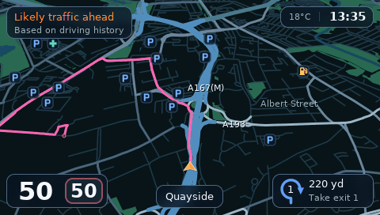 |

| HUD customisability | Browse and zoom the map |
| --- | --- |
|  |  |

| Route to a point on the map | Manual coordinate route |
| --- | --- |
| 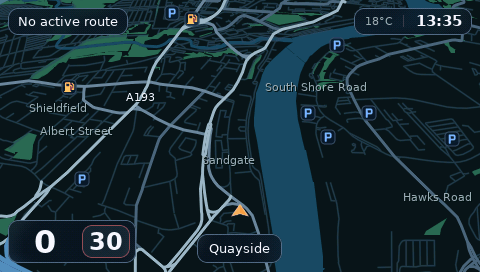 | 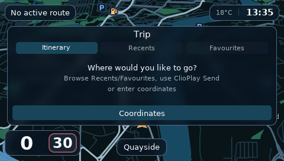 |

| Song and radio updates | Shared status notifications |
| --- | --- |
|  | 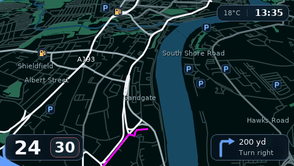 |

## Compatibility

The primary supported configuration is:

- Non-Bluetooth radio with a CD player (other radios will work, but likely with no live radio audio source info and volume info available)
- Non-live Carminat TomTom head unit
- Bluetooth remote control (Clio 3), or a physical console (Scénic 3, Mégane 3)

Physical console input and alternate temperature source (Scénic 3, Mégane 3) are detected
from incoming runtime events alongside the Bluetooth remote and Focus readings (Clio 3).
Both sources are available automatically. Existing
Focus temperature readings take priority when valid. See the
[console setup and controls](src/README.md#physical-console-and-temperature-sources).
The hardware protocol was contributed from a tested Scénic 3.

ClioPlay automatically discovers Bluetooth hardware on the Carminat; for Bluetooth, the Carminat must have: (`hw_bluetooth=1`). If no Bluetooth hardware is discovered, ClioPlay hides all Bluetooth-related UI features (Bluetooth audio and sending destinations by phone via <a href="https://pxwel-dev.github.io/ClioPlay-Send/">ClioPlay Send</a>).

ClioPlay handles the audio source as follows:

| Radio source read by ClioPlay | Source shown and used |
| --- | --- |
| CD / no-disc CD | **BT** |
| AUX | **AUX** |
| No valid live radio source | **BT**, independent of radio source/volume telemetry |
| FM / MW / LW | The reported radio source |

BT playback is available on CD and when no valid live radio source can be read;
BT CTRL also requires a connected phone. Unavailable radio/volume readings stay hidden.

## Features

- Offline OpenStreetMap navigation, routing, rerouting and chained secondary manoeuvre cues.
- Browse the map and route to a selected point, search offline **Nearby** Fuel/Parking/Hospital POIs, send destinations from a connected phone, or manually enter named decimal-degree lat/long coordinates.
- Manage stops, recents and favourites on the head unit or import/export them on desktop (`tools/favourites_tool.py` - CSV, JSON, GPX).
- Optional offline destination learning, historical traffic-aware ETAs and local diversions with on-map Explore preview based on personal GPS history.
- Bluetooth phone audio with instant AVRCP track updates and remote playback controls.
- Vehicle audio controls remain responsible for physical volume and mute.
- Full-screen maps with animated, semi-transparent frosted glass notices for road names, camera alerts, route progress and audio changes.
- Day/Night themes with custom daily switch times in Auto, automatic units and time zones, and 18 interface languages.
- Mapped speed limits and camera alerts where the bundled country policy allows them.

For new stops/destinations, enter **Coordinates** on the head unit, choose **Next** on the keypad to validate both fields and proceed to naming, or use the separate [ClioPlay Send website](https://pxwel-dev.github.io/ClioPlay-Send/) to send the new route to ClioPlay from your phone via Bluetooth. For ease of use, add the website to your Home Screen as a web app.

## Install

**Already using ClioPlay?** Follow the [software update guide](src/docs/updating.md) to retain your maps, settings, saved places, pairings and driving history without rebuilding navigation or downloading firmware.

The instructions below are for fresh installations or new navigation data.

You need a FAT32-formatted SD card (SDHC, minimum 2GB, recommended 8GB, theoretical max 32GB) for the head unit and one or more `.osm.pbf` map extracts covering your journeys.

Choose your regions and download their `.osm.pbf` files from [Geofabrik Downloads](https://download.geofabrik.de/). When combining extracts, use the same provider and snapshot so shared border data agrees. Download and extract this repository, then follow your desktop setup:

| Computer | Start here |
| --- | --- |
| **Windows 10/11** | Follow [Windows setup](WINDOWS.md), then double-click **Install.cmd**. Uses Ubuntu 24.04 through WSL 2. |
| **macOS** | Install `python`, `osmium-tool`, `llvm` and `cabextract` with Homebrew, then open **Install.command**. |
| **Linux (Ubuntu 24.04)** | Install `python3 python3-venv python3-pip build-essential osmium-tool cabextract` with `apt`, then run `python3 install.py`. |

1. Enter or drag in each `.osm.pbf` path. Press Enter on an empty prompt when done. The installer merges multiple selections and asks you to confirm the resulting coverage.
2. Let the installer build and check navigation data.
3. Select the SD-card root and confirm installation.
4. Safely eject it before use and insert into your car.

The installer downloads and checks the required official TomTom firmware.
It does not format the card. Replaced files are backed up. Any existing ClioPlay preferences,
pairings and saved places are preserved. Personal driving history stays on the SD card; do not include it in a release. No previous ClioPlay install is needed.
Map building can take substantial time for large extracts.

## Use your remote or console

Both inputs are available automatically and can be used together. Console names
below refer to the Scénic III / Mégane armrest controls. The upper-left and
upper-right console buttons act as the remote's soft keys.

| Remote control | Console equivalent | Action |
| --- | --- | --- |
| **MAP** | **MAP** | Restore Auto zoom after temporary manual zoom; return from **View diversion** to re-open the confirmation; otherwise switch between driving and map browsing, or return to driving from a menu. |
| **MENU** | **MENU** | Open the menu for Trip, Bluetooth and Settings. |
| **BACK** | **BACK** | Go back or dismiss a dialog. On the driving map with Bluetooth audio selected and a phone connected, toggle **BT CTRL**. |
| **Centre / OK** | **Press the knob** | On the driving map, press once to briefly show the current road name and (during guidance) ETA/distance, or press twice within 4 seconds to toggle the live expandable **GPS** HUD. In map browsing, select the crosshair point. In **BT CTRL**, play/pause. In menus, select or confirm. |
| **Up / Down** | **Joystick up / down** | Enter map browsing and pan, or move through menu rows. |
| **Left / Right** | **Joystick left / right** | Enter map browsing and pan, change tabs/options/settings, or select dialog choices. In **BT CTRL**, previous/next track. |
| **Left soft key** | **Upper-left button** | Zoom out; delete a character in coordinate/name entry. |
| **Right soft key** | **Upper-right button** | Zoom in; cycle latitude/longitude; insert a space in a name. |

Turning the console knob also zooms the map, skips tracks in **BT CTRL**, scrolls
lists and moves through keyboard/keypad buttons or dialog choices. In Settings,
turn it to choose a category and press to open it. Within a category, turn to
choose a row, use the joystick left/right to change its value, and press for
the row's OK action. Back returns to the category list.

Console shortcuts: **DEST** opens Trip; **LIGHT** cycles Day/Night/Auto;
**INFO** shows the current road name on the driving map and adds the journey
estimate during guidance; **REPEAT** toggles the live expandable GPS HUD.
Resume and arrival prompts must still be confirmed. No long press is needed for any remote action.

If you adjust the zoom while Auto zoom is enabled, **MAP** restores Auto zoom
without entering Explore. Press **MAP** again to enter Explore, or use an arrow
to enter Explore and pan directly. **OK** shows the road name and, during
guidance, the ETA; pressing **OK** a second time within 4 seconds toggles the
live GPS HUD on or off. This also works during temporary Manual zoom.

See the [full remote and console controls guide](src/README.md#remote-and-console-controls) for actions in
each screen, including settings, pairing and the favourite keyboard.

Menus now open as animated glass panels over the map. Menu, Bluetooth and
Settings retain the bottom driving pills when there is room; Trip and its entry
pages use a taller panel. Time and active status notices remain in place. Trip
always opens on **Itinerary**. **Left / Right** cycles through **Itinerary →
Recents → Favourites → Nearby**. On the itinerary's bottom row, **Left / Right** wraps
between action buttons, including **Cancel route**. Use **Up / Down** or the
console knob to move between rows and wrap at the ends. Press **OK** to open an
item, **BACK** to return one level,
or **MAP** to return directly to driving. **Pair new phone** stays at the top of
Bluetooth.

## Status and development

Some legacy helper sources remain unavailable: see [source status](SOURCE_STATUS.md).
Original ClioPlay contributions use the [MIT licence](LICENSE); dependencies and
map data retain their [own licences and notices](THIRD_PARTY_NOTICES.md).
ClioPlay is independent of Renault and TomTom.

For development, see [contributing](CONTRIBUTING.md) and [building](src/BUILDING.md).

Firmware, map extracts, generated navigation, personal settings and build caches
are excluded from Git. The [UI previews](src/docs/demo/README.md) use the
production renderer with controlled host inputs; it does not establish vehicle performance.

## Authorship and credits

ClioPlay was created and is maintained by [Pawel (pxwel-dev)](https://github.com/pxwel-dev), originally developed to modernise the factory-fitted Carminat TomTom navigation system in his 2010 Renault Clio.

Original ClioPlay development includes:

- Native application and animated graphical interface.
- Offline OpenStreetMap rendering, routing and navigation engine.
- Custom map format and navigation data generation pipeline.
- Bluetooth A2DP audio receiver and media playback integration.
- AVRCP-based destination transfer and the companion [ClioPlay Send](https://github.com/pxwel-dev/ClioPlay-Send) web application.
- Factory radio and vehicle data integration.
- SD card installation, configuration and release tooling.

### Contributions and acknowledgements

- [bobczan](https://github.com/bobczan) ([Renatka](https://github.com/bobczan/Renatka)) - physical Renault console protocol, button mappings and alternative vehicle temperature interface ([PR #2](https://github.com/pxwel-dev/ClioPlay/pull/2)), FAT32/exFAT install and Windows WSL preflight fixes ([PR #12](https://github.com/pxwel-dev/ClioPlay/pull/12), [PR #13](https://github.com/pxwel-dev/ClioPlay/pull/13)), and the opt-in pipelined atlas builder ([PR #11](https://github.com/pxwel-dev/ClioPlay/pull/11)).
- [qspi](https://github.com/qspi) - landlocked extract support in the ocean map builder ([PR #4](https://github.com/pxwel-dev/ClioPlay/pull/4)), NMEA `$GPGST`/HDOP/altitude parsing, antialiased compass dial and initial GPS information panel ([PR #8](https://github.com/pxwel-dev/ClioPlay/pull/8), subsequently adapted into the expandable live GPS HUD), and the Scénic III console knob push fix ([PR #18](https://github.com/pxwel-dev/ClioPlay/pull/18)).
- [OpenStreetMap](https://www.openstreetmap.org/copyright) and its contributors - geographic and navigation data.
- [Geofabrik](https://www.geofabrik.de/) - distribution of regional OpenStreetMap extracts.

Third-party software and dependencies retain their respective licences and attribution notices, as documented in [THIRD_PARTY_NOTICES.md](THIRD_PARTY_NOTICES.md).

Release files refreshed 26 November 2026 (Europe/London).
