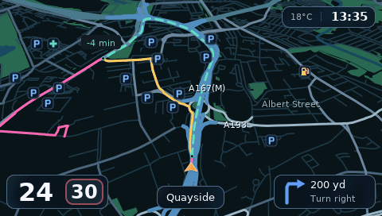
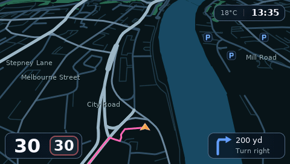
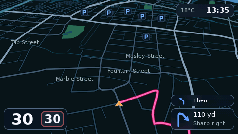
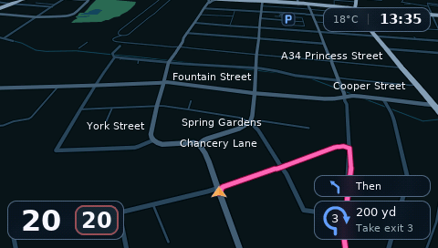
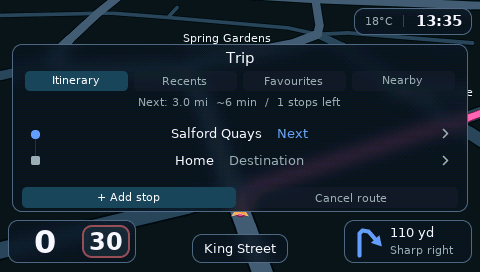
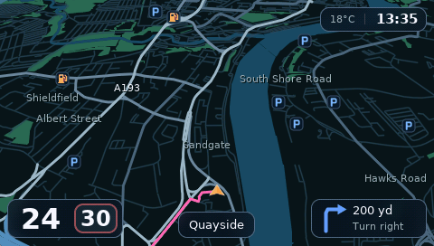

<!-- Generated from src/docs/repository-readme.md by src/tools/refresh_latest.py. -->

<h1 align="center">ClioPlay 2.2.0</h1>

Offline navigation and Bluetooth audio for the original Carminat TomTom screen.

  Created and maintained by <a href="https://github.com/pxwel-dev">Pawel (pxwel-dev)</a>.

<a href="https://github.com/pxwel-dev/ClioPlay/releases/tag/Release">Download latest release</a> · <a href="#install">Fresh install</a> · <a href="src/docs/updating.md">Update existing installation</a> · <a href="https://pxwel-dev.github.io/ClioPlay-Send/">Send a destination from your phone</a>

## Version 2.2.0 — Release

### Changes in this version

- Introduced optional, offline driving-history learning. Fresh GPS observations are recorded independently of active navigation and only successful Barcelona power-off sessions train the model.
- Added contextual destination suggestions to an empty Itinerary using the last saved GPS position, raw GPS time/day patterns and early trajectory evidence, with nearby Favourites/Recents matching.
- Added directional historical road-time profiles, traffic-adjusted ETAs and an explicit local Diversion choice with gold/yellow bypassed geometry and an aqua/teal alternative.
- Declining a diversion suppresses only its bypassed section; later independent offers remain available, and diversion confirmation initially selects Yes. Restored the original empty-Itinerary instructions alongside learned destinations.
- Added history, destination suggestion and diversion controls in Settings, including a confirmed clear-history action. 
- Fixed Bluetooth phone names and connected-state identity when switching between saved devices; both remain keyed by hardware address.
- Completed the new navigation and HUD translations across all 18 interface languages, and added missing-key regression checks.
- Added native regression cases and two controlled preview storyboards. Historical traffic is not live traffic.
- Added a software-only update mode with verified staged copies, a dated software backup and rollback; existing maps, settings and personal history remain untouched.

See [version history](CHANGELOG.md) for implemented changes by version.

See [intelligent navigation](src/docs/intelligent-navigation.md) for configuration, model behaviour and privacy.

## UI previews

See the [full preview index](src/docs/demo/README.md) for all animations.

| Destination prediction | Intelligent diversions |
| --- | --- |
|  |  |

| Driving and camera alerts | Dynamically-resizing, animated frosted-glass menu |
| --- | --- |
|  |  |

| Bluetooth playback and volume | Shared status notifications |
| --- | --- |
|  |  |

| Speeding warning | Browse and zoom the map |
| --- | --- |
|  |  |

| Roundabout route guidance and ETA | Add a stop from favourites |
| --- | --- |
|  |  |

| Manual coordinate route | Route to a point on the map |
| --- | --- |
|  |  |

| HUD Customisability | Song and radio updates |
| --- | --- |
|  |  |

<table align="center">
  <thead>
    <tr>
      <th>
        Send a destination with
        <a href="https://pxwel-dev.github.io/ClioPlay-Send/">ClioPlay Send</a>
      </th>
    </tr>
  </thead>
  <tbody>
    <tr>
      <td align="center">
        
      </td>
    </tr>
  </tbody>
</table>

## Compatibility

The primary supported configuration is:

- Non-Bluetooth radio with a CD player (other radios will work, but likely with no live radio audio source info and volume info available)
- Non-live Carminat TomTom head unit
- Bluetooth remote control (Clio 3), or a physical console (Scénic 3, Mégane 3)

Physical console input and alternate temperature source (Scénic 3, Mégane 3) are detected
from incoming runtime events alongside the Bluetooth remote and Focus readings (Clio 3).
Both sources are available automatically. Existing
Focus temperature readings take priority when valid. See the
[console setup and controls](src/README.md#physical-console-and-temperature-sources).
The hardware protocol was contributed from a tested Scénic 3.

ClioPlay automatically discovers Bluetooth hardware on the Carminat; for Bluetooth, the Carminat must have: (`hw_bluetooth=1`). If no Bluetooth hardware is discovered, ClioPlay hides all Bluetooth-related UI features (Bluetooth audio and sending destinations by phone via <a href="https://pxwel-dev.github.io/ClioPlay-Send/">ClioPlay Send</a>). 

ClioPlay handles the audio source as follows:

| Radio source read by ClioPlay | Source shown and used |
| --- | --- |
| CD / no-disc CD | **BT** |
| AUX | **AUX** |
| No valid live radio source | **BT**, independent of radio source/volume telemetry |
| FM / MW / LW | The reported radio source |

BT playback is available on CD and when no valid live radio source can be read;
BT CTRL also requires a connected phone. Unavailable radio/volume readings stay hidden.

## Features

- Offline OpenStreetMap navigation, routing and rerouting.
- Browse the map and route to a selected point, send destination from a connected phone, or manually enter named decimal-degree lat/long coordinates
- Manage stops, recents and favourites.
- Optional offline destination learning, historical traffic-aware ETAs and local diversions based on personal GPS history.
- Bluetooth phone audio with track information and remote playback controls.
- Vehicle audio controls remain responsible for physical volume and mute.
- Full-screen maps with animated, semi-transparent frosted glass notices for road names, camera alerts, route progress and audio changes.
- Day/Night themes with custom daily switch times in Auto, automatic units and time zones, and 18 interface languages.
- Mapped speed limits and camera alerts where the bundled country policy allows them.

For new stops/destinations, enter **Coordinates** on the head unit, choose **Next** on the keypad to validate both fields and proceed to naming, or use the separate [ClioPlay Send website](https://pxwel-dev.github.io/ClioPlay-Send/) to send the new route to ClioPlay from your phone via Bluetooth. For ease of use, add the website to your Home Screen as a web app.

## Install

**Already using ClioPlay?** Follow the [software update guide](src/docs/updating.md) to retain your maps, settings, saved places, pairings and driving history without rebuilding navigation or downloading firmware.

The instructions below are for fresh installations or new navigation data.

You need a FAT32-formatted SD card (SDHC, minimum 2GB, recommended 8GB, theoretical max 32GB) for the head unit and an `.osm.pbf` map extract covering your journeys.

Get the map extract from [Geofabrik Downloads](https://download.geofabrik.de/) by choosing your region and downloading its `.osm.pbf` file. Download and extract this repository, then follow your desktop setup:

| Computer | Start here |
| --- | --- |
| **Windows 10/11** | Follow [Windows setup](WINDOWS.md), then double-click **Install.cmd**. Uses Ubuntu 24.04 through WSL 2. |
| **macOS** | Install `python`, `osmium-tool`, `llvm` and `cabextract` with Homebrew, then open **Install.command**. |
| **Linux (Ubuntu 24.04)** | Install `python3 python3-venv python3-pip build-essential osmium-tool cabextract` with `apt`, then run `python3 install.py`. |

1. Choose your PBF and confirm its region.
2. Let the installer build and check navigation data.
3. Select the SD-card root and confirm installation.
4. Safely eject it before use and insert into your car.

The installer downloads and checks the required official TomTom firmware.
It does not format the card. Replaced files are backed up. Any existing ClioPlay preferences,
pairings and saved places are preserved. Personal driving history stays on the SD card; do not include it in a release. No previous ClioPlay install is needed.
Map building can take substantial time for large extracts.

## Use your remote or console

Both inputs are available automatically and can be used together. Console names
below refer to the Scénic III / Mégane armrest controls. The upper-left and
upper-right console buttons act as the remote's soft keys.

| Remote control | Console equivalent | Action |
| --- | --- | --- |
| **MAP** | **MAP** | Restore Auto zoom after temporary manual zoom; otherwise switch between driving and map browsing, or return to driving from a menu. |
| **MENU** | **MENU** | Open the menu for Trip, Bluetooth and Settings. |
| **BACK** | **BACK** | Go back or dismiss a dialog. On the driving map with Bluetooth audio selected and a phone connected, toggle **BT CTRL**. |
| **Centre / OK** | **Press the knob** | On the driving map, show ETA and remaining distance, or heading without a route. In map browsing, select the crosshair point. In **BT CTRL**, play/pause. In menus, select or confirm. |
| **Up / Down** | **Joystick up / down** | Enter map browsing and pan, or move through menu rows. |
| **Left / Right** | **Joystick left / right** | Enter map browsing and pan, change tabs/options/settings, or select dialog choices. In **BT CTRL**, previous/next track. |
| **Left soft key** | **Upper-left button** | Zoom out; previous Trip tab; delete a character in coordinate/name entry. |
| **Right soft key** | **Upper-right button** | Zoom in; next Trip tab; pair a phone from Bluetooth; cycle latitude/longitude; insert a space in a name. |

Turning the console knob also zooms the map, skips tracks in **BT CTRL**, scrolls
lists and moves through keyboard/keypad buttons or dialog choices. In Settings,
turn it to choose a row, use the joystick left/right to change its value, and
press it for the row's OK action.

Console shortcuts: **DEST** opens Trip; **LIGHT** cycles Day/Night/Auto;
**INFO** and **REPEAT** show the journey overview on the map (heading without a
route). REPEAT displays information; it does not speak instructions. Resume and
arrival prompts must still be confirmed. No long press is needed for any remote action.

If you adjust the zoom while Auto zoom is enabled, **MAP** restores Auto zoom
without entering Explore. Press **MAP** again to enter Explore, or use an arrow
to enter Explore and pan directly. **OK** shows the ETA during guidance, including
while temporary Manual zoom is active.

See the [full remote and console controls guide](src/README.md#remote-and-console-controls) for actions in
each screen, including settings, pairing and the favourite keyboard.

Menus now open as animated glass panels over the map. Menu, Bluetooth and
Settings retain the bottom driving pills when there is room; Trip and its entry
pages use a taller panel. Time and active status notices remain in place. Trip
always opens on **Itinerary**; **Left / Right** or the soft keys cycle through
**Itinerary → Recents → Favourites**, and **Up / Down** or the console knob scrolls
the current list. Press **OK** to open an item, **BACK** to return one level,
or **MAP** to return directly to driving. **Pair new phone** stays at the top of
Bluetooth and is also available with its right soft key.

## Status and development

Some legacy helper sources remain unavailable: see [source status](SOURCE_STATUS.md).
Original ClioPlay contributions use the [MIT licence](LICENSE); dependencies and
map data retain their [own licences and notices](THIRD_PARTY_NOTICES.md).
ClioPlay is independent of Renault and TomTom.

For development, see [contributing](CONTRIBUTING.md) and [building](src/BUILDING.md).

Firmware, map extracts, generated navigation, personal settings and build caches
are excluded from Git. The [UI previews](src/docs/demo/README.md) use the
production renderer with controlled host inputs; it does not establish vehicle performance.

## Authorship and credits

ClioPlay was created and is maintained by [Pawel (pxwel-dev)](https://github.com/pxwel-dev), originally developed to modernise the factory-fitted Carminat TomTom navigation system in his 2010 Renault Clio.

Original ClioPlay development includes:

- Native application and animated graphical interface.
- Offline OpenStreetMap rendering, routing and navigation engine.
- Custom map format and navigation data generation pipeline.
- Bluetooth A2DP audio receiver and media playback integration.
- AVRCP-based destination transfer and the companion [ClioPlay Send](https://github.com/pxwel-dev/ClioPlay-Send) web application.
- Factory radio and vehicle data integration.
- SD card installation, configuration and release tooling.

### Contributions and acknowledgements

- [bobczan/Renatka](https://github.com/bobczan/Renatka) — physical Renault console protocol, button mappings and alternative vehicle temperature interface, subsequently integrated into ClioPlay's native application.
- [OpenStreetMap](https://www.openstreetmap.org/copyright) and its contributors — geographic and navigation data.
- [Geofabrik](https://www.geofabrik.de/) — distribution of regional OpenStreetMap extracts.

Third-party software and dependencies retain their respective licences and attribution notices, as documented in [THIRD_PARTY_NOTICES.md](THIRD_PARTY_NOTICES.md).

Release files refreshed 19 November 2026 (Europe/London).
