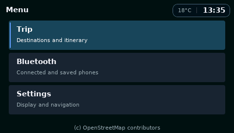
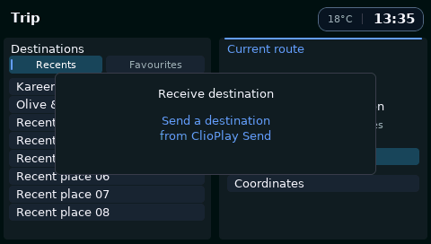
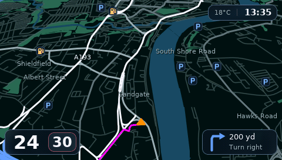
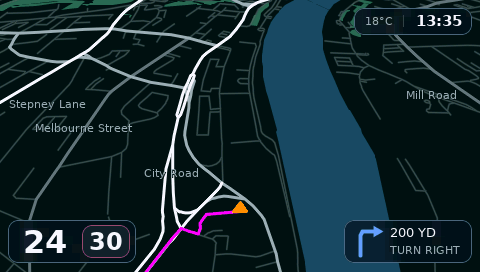
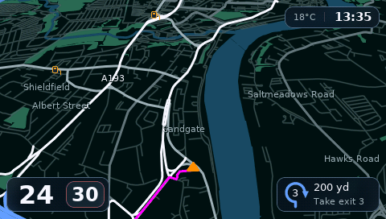
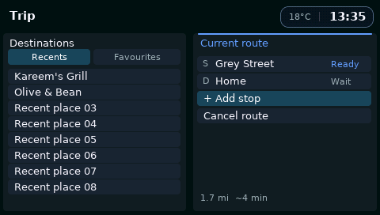
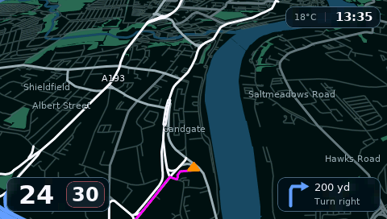

<!-- Generated from src/docs/repository-readme.md by src/tools/refresh_latest.py. -->

<h1 align="center">CLIOPLAY 2.0.0</h1>

Offline navigation and Bluetooth audio for the original Carminat TomTom screen.

<a href="#install">Install</a> · <a href="https://pxwel-dev.github.io/ClioPlay-Send/">Send a destination from your phone</a>

## UI previews

| Driving and camera alerts | Trip, favourites and settings |
| --- | --- |
|  |  |

| Bluetooth playback and volume | Receiving a phone destination |
| --- | --- |
|  |  |

| Speeding warning | Browse and zoom the map |
| --- | --- |
|  |  |

| Roundabout guidance and ETA | Add a stop from favourites |
| --- | --- |
|  |  |

| Shared status notifications | Song and radio updates |
| --- | --- |
|  |  |

## Compatibility

This preview release of ClioPlay currently only supports vehicles that have the following:

- Non-Bluetooth radio with a CD player
- Non-live Carminat TomTom head unit
- Bluetooth remote control used to operate the Carminat

Expect support very soon for physical console controls found on vehicles that do not have a Bluetooth remote control for their Carminat unit, such as Renault Scenic and Megane models. 

Confirmed that vehicles which use the physical console controls in place of Bluetooth remote control for their Carminat STILL have integrated Bluetooth hardware inside of their Carminat units, meaning that vehicles that don't have any factory Bluetooth capability in their radios will be able to benefit from Bluetooth audio implemented inside ClioPlay. 

## Features

- Offline OpenStreetMap navigation, routing and rerouting.
- Browse the map, choose destinations, manage stops, recents and favourites.
- Bluetooth phone audio with track information and remote playback controls.
- Steering wheel audio controls.
- Full-screen maps with animated, semi-transparent frosted glass notices for road names, camera alerts, route progress and audio changes.
- Day/Night themes with custom daily switch times in Auto, automatic units and time zones, and 18 interface languages.
- Mapped speed limits and camera alerts where the bundled country policy allows them.

For new stops/destinations that aren’t already in ClioPlay’s recents/favourites list, use the separate [ClioPlay Send website](https://pxwel-dev.github.io/ClioPlay-Send/) to send the new route to ClioPlay from your phone via Bluetooth. For ease of use, add the website to your Home Screen as a web app. 

## Install

You need an SD card for the head unit (minimum 8GB, ensuring that it’s already formatted to FAT32) and an `.osm.pbf` map extract covering your
journeys. Get the map extract from [Geofabrik Downloads](https://download.geofabrik.de/)
by choosing your region and downloading its `.osm.pbf` file. Download and extract
this repository, then follow your desktop setup:

| Computer | Start here |
| --- | --- |
| **Windows 10/11** | Follow [Windows setup](WINDOWS.md), then double-click **Install.cmd**. Uses Ubuntu 24.04 through WSL 2. |
| **macOS** | Install `python`, `osmium-tool`, `llvm` and `cabextract` with Homebrew, then open **Install.command**. |
| **Linux (Ubuntu 24.04)** | Install `python3 python3-venv python3-pip build-essential osmium-tool cabextract` with `apt`, then run `python3 install.py`. |

1. Choose your PBF and confirm its region.
2. Let the installer build and check navigation data.
3. Select the SD-card root and confirm installation.
4. Safely eject it before use and insert into your car. 

The installer downloads and checks the required official TomTom firmware.
It does not format the card. Replaced files are backed up. Any existing ClioPlay preferences,
pairings and saved places are preserved. No previous ClioPlay install is needed.
Map building can take substantial time for large extracts.

## Use your remote

| Control | Action |
| --- | --- |
| **MAP** | Restore Auto zoom after temporary manual zoom; otherwise switch between driving and map browsing, or return to driving from a menu. |
| **MENU** | Open the menu for Trip, Bluetooth and Settings. |
| **BACK** | Go back or dismiss a dialog. On the driving map with Bluetooth audio selected and a phone connected, toggle **BT CTRL**. |
| **Centre / OK** | On the driving map, show the ETA and remaining distance, or the heading without a route. In map browsing, select the point under the crosshair. In **BT CTRL**, play or pause. In menus, select or confirm. |
| **Up / Down** | Pan the map or move through menu rows. |
| **Left / Right** | Pan the map or change the selected tab, option or value. In **BT CTRL**, play the previous or next track. |
| **Left soft key** | Zoom out on the map, focus destinations in Trip, or delete while naming a favourite. |
| **Right soft key** | Zoom in on the map, focus the itinerary in Trip, or insert a space while naming a favourite. |

If you adjust the zoom while Auto zoom is enabled, **MAP** restores Auto zoom
without entering Explore. Press **MAP** again to enter Explore, or use an arrow
to enter Explore and pan directly. **OK** shows the ETA during guidance, including
while temporary Manual zoom is active.

See the [full remote controls guide](src/README.md#remote-controls) for actions in
each screen, including settings, pairing and the favourite keyboard.

## Status and development

Some legacy helper sources remain unavailable: see [source status](SOURCE_STATUS.md).
Original ClioPlay contributions use the [MIT licence](LICENSE); dependencies and
map data retain their [own licences and notices](THIRD_PARTY_NOTICES.md).
ClioPlay is independent of Renault and TomTom.

For development, see [contributing](CONTRIBUTING.md) and [building](src/BUILDING.md).

Firmware, map extracts, generated navigation, personal settings and build caches
are excluded from Git. The [UI previews](src/docs/demo/README.md) use the
production renderer with controlled host inputs; it does not establish vehicle performance.

Release files refreshed 11 November 2026 (Europe/London).
