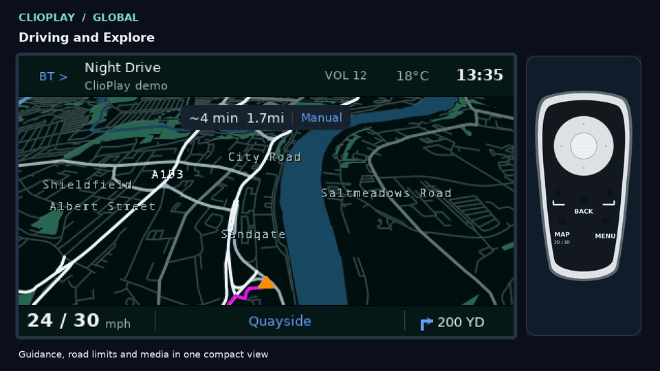

<!-- Generated from src/docs/repository-readme.md by src/tools/refresh_latest.py. -->

<h1 align="center">CLIOPLAY GLOBAL</h1>

Offline navigation and Bluetooth audio for the original Carminat TomTom screen and remote.

<a href="src/docs/demo/clioplay-demo.mp4">Watch the 6:48 demo</a> · <a href="#install">Install</a> · <a href="https://pxwel-dev.github.io/ClioPlay-Send/">Send a destination from your phone</a>

**Preview release** for **non-LIVE Carminat TomTom units without factory Bluetooth**.
Designed for the factory 480 × 272 screen and physical remote. Factory
Bluetooth/hands-free coexistence is outside this edition.

## What it does

- Offline OpenStreetMap navigation, routing and rerouting.
- Browse the map, choose destinations, manage stops, recents and favourites.
- Bluetooth phone audio with track information and remote playback controls.
- Day/Night themes, automatic units and time zones, and 18 interface languages.
- Mapped speed limits and camera alerts where the bundled country policy allows them.

Optional phone destinations use the separate [ClioPlay Send website](https://pxwel-dev.github.io/ClioPlay-Send/).
Its website and source are maintained separately from this repository.

## Install

You need an SD card for the head unit and an `.osm.pbf` map extract covering your
journeys. Get the map extract from [Geofabrik Downloads](https://download.geofabrik.de/)
by choosing your region and downloading its `.osm.pbf` file. Download and extract
this repository, then follow your desktop setup:

| Computer | Start here |
| --- | --- |
| **Windows 10/11** | Follow [Windows setup](WINDOWS.md), then double-click **Install.cmd**. Uses Ubuntu 24.04 through WSL 2. |
| **macOS** | Install `python`, `osmium-tool`, `llvm` and `cabextract` with Homebrew, then open **Install.command**. |
| **Linux (Ubuntu 24.04)** | Install `python3 python3-venv python3-pip build-essential osmium-tool cabextract` with `apt`, then run `python3 install.py`. |

1. Choose your PBF and confirm its region.
2. Let the installer build and check navigation data.
3. Select the SD-card root and confirm installation.
4. Keep the car off while preparing the card. Safely eject it before use.

The installer downloads and checks the required official TomTom firmware.
It does not format the card. Replaced files are backed up; existing preferences,
pairings and saved places are preserved. No previous ClioPlay install is needed.
Map building can take substantial time for large extracts.

## Use your remote

| Control | Action |
| --- | --- |
| **MAP** | Switch between driving and map browsing |
| **Direction pad** | Browse the map or move through menus |
| **Soft keys** | Zoom the map; follow the on-screen actions in menus |
| **Centre / OK** | Select or confirm |
| **MENU** | Open Trip, Bluetooth or Settings |
| **BACK** | Return; toggle phone playback controls on the driving screen |

See the [user guide](src/README.md) for trips, pairing and settings.

## Status and development

This is a preview, with host-tested builds. Boot, physical controls, audio,
wireless behaviour, routing speed, frame timing and memory still require
head-unit validation.

Some legacy helper sources remain unavailable: see [source status](SOURCE_STATUS.md).
Original ClioPlay contributions use the [MIT licence](LICENSE); dependencies and
map data retain their [own licences and notices](THIRD_PARTY_NOTICES.md).
ClioPlay is independent of Renault and TomTom.

For development, see [contributing](CONTRIBUTING.md), [building](src/BUILDING.md).

Release files refreshed 23 October 2026 (Europe/London).
